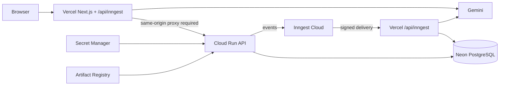
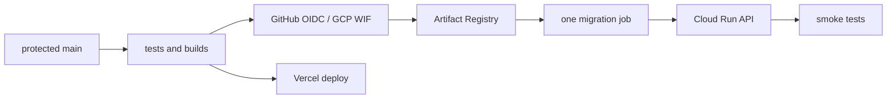

# Production deployment guide

This manual runbook is repository-specific. It does not mean any cloud resource already exists. Run commands from the repository root in PowerShell unless noted. Do not put credentials in source, logs, shell history, or public environment variables.

## A. Architecture overview

| Component    | Actual entry point                                  | Production host            |
| ------------ | --------------------------------------------------- | -------------------------- |
| Frontend     | apps/web (@repo/web, Next.js 15)                    | Vercel                     |
| API          | apps/api/src/server.ts (@repo/api, Express 5)       | Cloud Run                  |
| Database     | packages/database, Prisma 7                         | Neon PostgreSQL            |
| Durable jobs | `packages/jobs` served by `apps/web` `/api/inngest` | Vercel (serverless)        |
| AI knowledge | packages/ai and BOOKLEAF_KNOWLEDGE_BASE.md          | traced into `/api/inngest` |



The API and the job endpoint deploy independently because browser/API traffic and durable background execution have different scaling and failure profiles. Inngest Cloud delivers events, retries, and cron schedules; `packages/jobs` is the function-serving package and `apps/web` serves it — there is no separate always-on worker service.

## B. Prerequisites

Install Node.js 22+, Git, Docker Desktop, pnpm 10.23.0, Vercel CLI, GitHub CLI, and Google Cloud CLI.

```powershell
node --version
corepack enable
corepack prepare pnpm@10.23.0 --activate
pnpm --version
git --version
docker version
npm install --global vercel
vercel --version
gh --version
gcloud --version
```

Docker Desktop must be running. GCP access needs least-privilege permission for Artifact Registry, Cloud Run, Service Accounts, Secret Manager, required APIs, and billing. Review costs before creating Registry, Secret Manager, or Cloud Run resources.

## C. Account authentication and repository discovery

Use only these accounts: Vercel and GitHub: kartikeybhatnagar247@gmail.com. GCP: bhatnagarkartikey61@gmail.com. Stop on mismatch; never silently switch accounts.

```powershell
vercel login
vercel whoami
gh auth login --hostname github.com --web
gh auth status
gh api user --jq .login
gcloud auth login bhatnagarkartikey61@gmail.com
gcloud auth list
gcloud config set project <GCP_PROJECT_ID>
gcloud config list
git remote -v
gh repo view --json nameWithOwner,url,defaultBranchRef
gh workflow list
```

Expected results are the listed identities, an active GCP account/project, the intended GitHub repository (`origin` is `kartikey2004-git/BookLeaf`), and GitHub Actions workflows `backend-quality.yml`, `dependency-security.yml`, and `production-deploy.yml`. Only `production-deploy.yml` deploys (manual dispatch; Cloud Run API + Vercel frontend); the quality workflows verify.

Root scripts are pnpm build, typecheck, lint, test, test:integration, db:generate, and db:migrate. The workspace uses apps/* and packages/*; turbo builds dependencies first.

## D. Neon PostgreSQL and Prisma

**Neon console:** create a project in a region near Mumbai, then separate development and production branches. Obtain pooled runtime and direct migration URLs, each with sslmode=require. Keep values only in the secret manager.

The pooled URL is for API connections. The direct URL is only for one controlled migration release. `packages/database/prisma.config.ts` loads the workspace-root `.env` and prefers `DIRECT_URL` over `DATABASE_URL` for migration commands, so migrations never use the pooled URL. Never run migrations on application startup.

```powershell
pnpm --filter @repo/database generate
pnpm --filter @repo/database validate
pnpm --filter @repo/database migrate:deploy
pnpm --filter @repo/database exec prisma migrate status --config prisma.config.ts
```

Run migrate:deploy exactly once with the direct production URL, then verify status and API readiness. Enable Neon backup/recovery and rehearse restore on a non-production branch. See [Neon docs](https://neon.com/docs).

## E. Google Cloud setup

```powershell
$PROJECT_ID='<GCP_PROJECT_ID>'
$REGION='asia-south1'
$REPOSITORY='bookleaf'
$API_SERVICE='bookleaf-api'
gcloud config set project $PROJECT_ID
gcloud billing projects describe $PROJECT_ID
gcloud services enable run.googleapis.com artifactregistry.googleapis.com secretmanager.googleapis.com iamcredentials.googleapis.com cloudbuild.googleapis.com
gcloud artifacts repositories create $REPOSITORY --repository-format=docker --location=$REGION --description='BookLeaf production images'
gcloud artifacts repositories describe $REPOSITORY --location=$REGION
gcloud auth configure-docker "$REGION-docker.pkg.dev"
gcloud iam service-accounts create bookleaf-api --display-name='BookLeaf API runtime'
gcloud secrets create database-url --replication-policy=automatic
```

Billing must be enabled. API enablement, Artifact Registry, Cloud Run, and Secret Manager can incur cost. Create secrets for the database URL, Better Auth, Inngest, Gemini, and optional GitHub OAuth values. Upload values via secure stdin or provider UI, never inline. Grant the runtime service account Secret Accessor only on required secrets. Cloud Run sends stdout/stderr to Cloud Logging; verify with gcloud run services logs read $API_SERVICE --region=$REGION --limit=50.

## F. API Docker production build

The production Dockerfile is available at `apps/api/Dockerfile`. It builds from the repository root, generates Prisma, builds and verifies the AI artifact, and runs as a non-root user with a health check. Workspace packages currently export TypeScript source, so `tsx` remains in the runtime image as the required source loader.

Cloud Run's `PORT` is mapped to the existing `API_PORT` setting when the local override is unset. Deploy with `API_HOST=0.0.0.0`.

```powershell
docker build -f apps/api/Dockerfile -t bookleaf-api:local .
docker run --rm -p 8080:8080 --env-file .env bookleaf-api:local
$TAG=(git rev-parse --short HEAD)
$API_IMAGE="$REGION-docker.pkg.dev/$PROJECT_ID/$REPOSITORY/api:$TAG"
docker tag bookleaf-api:local $API_IMAGE
docker push $API_IMAGE
gcloud artifacts docker images list "$REGION-docker.pkg.dev/$PROJECT_ID/$REPOSITORY"
```

Test API at /api/v1/health/live, and run pnpm --filter @repo/ai test:artifact in the image build.

## G. Cloud Run API deployment

```powershell
gcloud run deploy $API_SERVICE --image=$API_IMAGE --region=$REGION --service-account="bookleaf-api@$PROJECT_ID.iam.gserviceaccount.com" --port=8080 --min-instances=0 --max-instances=10 --concurrency=80 --timeout=60s --set-env-vars="NODE_ENV=production,API_HOST=0.0.0.0,WEB_ORIGIN=https://<vercel-project>.vercel.app,CORS_ORIGINS=https://<vercel-project>.vercel.app,READINESS_CHECK_DATABASE=true" --set-secrets="DATABASE_URL=database-url:latest,BETTER_AUTH_SECRET=better-auth-secret:latest,INNGEST_EVENT_KEY=inngest-event-key:latest,INNGEST_SIGNING_KEY=inngest-signing-key:latest,GEMINI_API_KEY=gemini-api-key:latest" --allow-unauthenticated
gcloud run services describe $API_SERVICE --region=$REGION --format='value(status.url)'
Invoke-WebRequest https://<api-url>/api/v1/health/live
Invoke-WebRequest https://<api-url>/api/v1/health/ready
```

Public ingress is only for browser/API routes; Better Auth protects application access. Health paths are /api/v1/health/live and /api/v1/health/ready. Set READINESS_CHECK_DATABASE=true to include Neon in readiness.

## H. Inngest jobs (Vercel serverless endpoint)

`apps/web` serves the shared `@repo/jobs` functions at `/api/inngest` — `process-ticket-ai`, the `recover-pending-ticket-ai` ten-minute sweep, and the `infrastructure-heartbeat` handler. There is no separate worker service to deploy; do not create one. The endpoint is configured for a 60-second maximum duration and each AI job runs as an Inngest step, so AI work is split into separate invocations. `INNGEST_APP_ID` defaults to `foundation-worker` (kept for continuity with the existing Inngest app registration); set it explicitly to override.

**Inngest console:** configure production event/signing keys and add `https://<vercel-project>.vercel.app/api/inngest` as the production serve endpoint. Confirm discovery, then send `foundation/heartbeat.requested`. `process-ticket-ai` retries 2 times with concurrency 5; atomic database claiming prevents duplicate processing — the recovery sweep runs every 10 minutes and retries PENDING/FAILED tickets up to five attempts.

Set these in the Vercel project environment (encrypted): `INNGEST_EVENT_KEY`, `INNGEST_SIGNING_KEY`, `DATABASE_URL` (pooled Neon URL), `GEMINI_API_KEY`, and optionally `INNGEST_APP_ID` and `GEMINI_MODEL`/`GEMINI_TIMEOUT_MS`. The deployment pipeline (`production-deploy.yml`) already passes Inngest keys to Cloud Run API; the Vercel endpoint needs the same keys in its own environment.

## I. Vercel frontend deployment

Inspect before linking; do not create a duplicate project.

```powershell
vercel teams ls
vercel projects ls
vercel project inspect --cwd apps/web --non-interactive
vercel link --cwd apps/web
vercel env ls --cwd apps/web
vercel deploy --cwd apps/web
vercel deploy --cwd apps/web --prod
vercel inspect <deployment-url>
vercel logs <deployment-url>
```

Set apps/web as Root Directory. Next config transpiles @repo/ai, @repo/auth, @repo/contracts, @repo/database, @repo/jobs, and @repo/ui, and traces `packages/ai/dist/BOOKLEAF_KNOWLEDGE_BASE.md` into `/api/inngest`; preserve the root lockfile. Configure only public NEXT_PUBLIC_API_URL in Vercel. See [Vercel CLI](https://vercel.com/docs/cli).

## J. Better Auth, networking, and SSE

The web application has a same-origin route proxy for `/api/auth/*`, `/api/v1/*`, and SSE. Set server-only `API_PROXY_URL` to the Cloud Run API origin. Browser requests use relative `/api` paths with credentials; the proxy forwards cookies, `Set-Cookie`, `Last-Event-ID`, request bodies, and cancellation without buffering the upstream response.

Set BETTER_AUTH_URL, WEB_ORIGIN, CORS_ORIGINS, and BETTER_AUTH_TRUSTED_ORIGINS to the exact Vercel origin. The current API requires CORS/trusted-origin equality and credentials: true. Browser-test sign-in, refresh persistence, roles, sign-out, SSE connection/reconnect/disconnect, and rejected foreign origins. Add a future custom domain to every origin setting before cutover.

## K. GitHub Actions and CLI workflow

```powershell
gh workflow list
gh run list --limit 20
gh run view <RUN_ID> --log-failed
```

`production-deploy.yml` is the reviewed production workflow (manual dispatch with a `release_ref` input): frozen install; format/lint/typecheck/unit tests; disposable-database migration and integration suite; API image build/push to Artifact Registry; exactly one direct-URL migration; Cloud Run API deploy; Vercel prebuilt deploy; live smoke tests. Store IDs as repository variables and values as protected Environment secrets. Use GitHub OIDC Workload Identity Federation with narrowly scoped GCP roles, never permanent service-account JSON keys. Pin actions to commit SHA and require production approval.



## L. Complete manual deployment sequence

1. Verify tools and named accounts.
2. Confirm remote/repository, scripts, and clean baseline checks.
3. Create Neon branches; retain pooled/direct secrets; prepare direct migration configuration.
4. Select funded GCP project; enable APIs, Registry, runtime accounts, and secret access.
5. Implement/test Dockerfile, proxy, and migration configuration.
6. Build/test/tag/push immutable API images.
7. Deploy API and verify live/database-ready endpoints.
8. Configure the Vercel `/api/inngest` serve endpoint in Inngest; verify discovery and the heartbeat function.
9. Run exactly one controlled migration and confirm status.
10. Configure Vercel, deploy preview then production.
11. Verify Better Auth, roles, SSE, AI assets/jobs, logs, and CI.

At each stage, stop on failure, inspect provider logs, correct the cause, then rerun only the failed stage.

## M. Verification and troubleshooting

Verify Vercel frontend, API health/readiness, sign-in/refresh/sign-out/roles, database read/write/migration status, authenticated SSE lifecycle, Inngest discovery/retries, AI artifact/job completion, ready Cloud Run revisions/logs, and protected green CI.

| Symptom                              | Recovery                                                                          |
| ------------------------------------ | --------------------------------------------------------------------------------- |
| Workspace packages missing in Docker | Build from root; retain workspace manifests/lockfile; build dependencies first.   |
| Prisma client missing                | Run database generate in image build and copy generated output.                   |
| Neon SSL failure                     | Use correct branch URL with sslmode=require; pooled runtime/direct migration URL. |
| Cloud Run startup failure            | Bind 0.0.0.0:PORT; fix API port handling.                                         |
| Cookie/CORS failure                  | Same-origin proxy, exact trusted/CORS origins, credentials, HTTPS cookies.        |
| SSE disconnect                       | Do not buffer; forward cancellation/cookies; inspect timeout.                     |
| Inngest signature failure            | Recheck signing key and the exact `/api/inngest` endpoint.                        |
| AI asset missing                     | Run AI build/artifact test; the knowledge base is traced into `/api/inngest`.     |
| Vercel failure                       | Confirm apps/web root; inspect logs; validate workspace build.                    |
| GitHub GCP auth failure              | Check WIF provider condition, repository/ref claims, IAM binding.                 |

## N. Rollback and maintenance

```powershell
gcloud run revisions list --service=$API_SERVICE --region=$REGION
gcloud run services update-traffic $API_SERVICE --region=$REGION --to-revisions=<READY_REVISION>=100
vercel ls --cwd apps/web
vercel rollback <deployment-url>
gcloud run services logs read $API_SERVICE --region=$REGION --limit=100
```

Route traffic to a healthy Cloud Run revision or redeploy its immutable image; redeploy the previous Vercel production deployment if the frontend/jobs endpoint regresses. Do not destructively roll back database history: restore application compatibility and use forward migration or tested Neon recovery. Rotate secrets by adding a new Secret Manager version, rolling services one at a time, validating, then disabling the old version. Review Cloud Run, Inngest, Vercel, GitHub Actions, and Neon backup health regularly.

Further reference: [Cloud Run](https://cloud.google.com/run/docs), [Artifact Registry](https://cloud.google.com/artifact-registry/docs), [Secret Manager](https://cloud.google.com/secret-manager/docs), and [GitHub OIDC](https://docs.github.com/actions/security-for-github-actions/security-hardening-your-deployments/configuring-openid-connect-in-google-cloud-platform).
