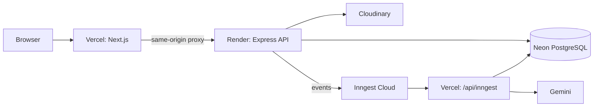

# Render production deployment guide

BookLeaf production uses Vercel for Next.js and `/api/inngest`, Render for the Express API, Neon for PostgreSQL, and Cloudinary for ticket attachments. No GCP, Cloud Run, Artifact Registry, or GCP service account is required.



## Neon

Create separate Neon development and production branches. Keep the production pooled and direct migration URLs private, both with `sslmode=require`.

- `DATABASE_URL`: pooled production URL for Render and Vercel `/api/inngest`.
- `DIRECT_URL`: direct URL for the single controlled Prisma migration run in GitHub Actions.

The deployment workflow runs `pnpm --filter @repo/database migrate:deploy` only when the protected `NEON_DIRECT_DATABASE_URL` GitHub secret is present. Never run migration commands at API startup.

## Render API

Create the API from repository-root [`render.yaml`](../../render.yaml). It defines the Docker service `bookleaf-api`, builds `apps/api/Dockerfile` from the repository root, checks `/api/v1/health/live`, and deploys only after GitHub checks pass.

During the initial Render Blueprint setup, supply these prompted secrets:

- `DATABASE_URL` — Neon pooled URL.
- `WEB_ORIGIN`, `CORS_ORIGINS`, `BETTER_AUTH_URL`, and `BETTER_AUTH_TRUSTED_ORIGINS` — the exact Vercel production origin. CORS and trusted origins must match.
- `INNGEST_EVENT_KEY` and `INNGEST_SIGNING_KEY` — production Inngest keys.
- `GEMINI_API_KEY` — only when AI suggestions are enabled.
- `CLOUDINARY_CLOUD_NAME` and `CLOUDINARY_UPLOAD_PRESET` — production attachment configuration.

Render supplies `PORT`; the API maps it automatically when `API_PORT` is not set. Verify:

```text
https://<render-api-origin>/api/v1/health/live
https://<render-api-origin>/api/v1/health/ready
```

## Vercel and Inngest

The Vercel project Root Directory is `apps/web`, with Node.js 22. Configure production secrets/config:

| Variable              | Value                                                                      |
| --------------------- | -------------------------------------------------------------------------- |
| `API_PROXY_URL`       | Exact Render API HTTPS origin, no trailing slash                           |
| `NEXT_PUBLIC_API_URL` | Same Render origin when needed; browser calls otherwise use `/api/*` proxy |
| `DATABASE_URL`        | Neon pooled URL                                                            |
| `INNGEST_EVENT_KEY`   | Production event key                                                       |
| `INNGEST_SIGNING_KEY` | Production signing key                                                     |
| `GEMINI_API_KEY`      | Production Gemini key when enabled                                         |

Register `https://<vercel-production-origin>/api/inngest` as the production endpoint in Inngest Cloud. Do not create a separate worker service.

## Cloudinary

Create a production unsigned upload preset restricted to the accepted attachment types and 10 MB maximum. Put `CLOUDINARY_CLOUD_NAME` and `CLOUDINARY_UPLOAD_PRESET` only on Render. Do not expose Cloudinary administration credentials or server secrets to the browser.

## CI/CD

`production-deploy.yml` runs quality checks, the disposable PostgreSQL integration suite, the controlled Neon migration, and the Vercel prebuilt deployment. Render follows the same commit after GitHub checks pass through `autoDeployTrigger: checksPass`.

Required GitHub secrets: `NEON_DIRECT_DATABASE_URL`, `VERCEL_TOKEN`.

Required GitHub variables: `VERCEL_ORG_ID`, `VERCEL_PROJECT_ID`.

## Release verification

Confirm green GitHub Actions, successful Render and Vercel deployments, API liveness/readiness, browser auth, author/admin ticket flow, a Cloudinary attachment upload, closed-ticket reply blocking, and Inngest endpoint discovery before marking a release complete.
