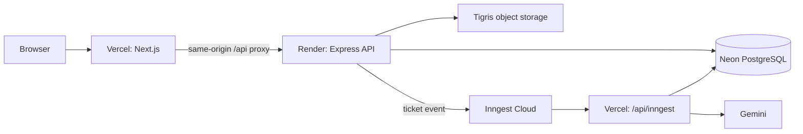

# Production deployment: Vercel, Render, Neon, Inngest, and Tigris

Production consists of Vercel for the Next.js application and Inngest endpoint, Render for the Express API, Neon for PostgreSQL, Inngest Cloud for durable jobs, Tigris for attachments, and Gemini for server-side AI calls.



## 1. Neon

Create separate Neon branches for development and production. Give runtime services the production **pooled** connection URL as `DATABASE_URL`. Run Prisma migrations once from the reviewed release workflow using the production **direct** connection URL as `DIRECT_URL`; never run migrations when the Render API starts.

Both URLs must use TLS. Keep them in provider/GitHub secret storage and never put either in `NEXT_PUBLIC_*` variables.

## 2. Render API

Create the service from repository-root [`render.yaml`](../../render.yaml). It builds `apps/api/Dockerfile` from the monorepo root and uses `/api/v1/health/live` as its liveness check. Render supplies `PORT`; the API uses it when `API_PORT` is not set.

Set these Render environment variables:

| Variable                                                                     | Required             | Notes                                                                         |
| ---------------------------------------------------------------------------- | -------------------- | ----------------------------------------------------------------------------- |
| `NODE_ENV`                                                                   | Yes                  | `production`                                                                  |
| `DATABASE_URL`                                                               | Yes                  | Neon pooled production URL                                                    |
| `BETTER_AUTH_SECRET`                                                         | Yes                  | One stable high-entropy value                                                 |
| `BETTER_AUTH_URL`                                                            | Yes                  | Exact Vercel production origin                                                |
| `BETTER_AUTH_TRUSTED_ORIGINS`                                                | Yes                  | Exact browser origins, comma-separated                                        |
| `WEB_ORIGIN`, `CORS_ORIGINS`                                                 | Yes                  | Same origin set as Better Auth trusted origins                                |
| `INNGEST_EVENT_KEY`                                                          | Yes for triage       | Production Inngest event key                                                  |
| `INNGEST_SIGNING_KEY`                                                        | No                   | Needed only if serving jobs from Render; production jobs are served by Vercel |
| `GEMINI_API_KEY`                                                             | Yes for admin drafts | Server-side Gemini key                                                        |
| `TIGRIS_ENDPOINT`, `TIGRIS_ACCESS_KEY`, `TIGRIS_SECRET_KEY`, `TIGRIS_BUCKET` | Yes for attachments  | S3-compatible Tigris configuration                                            |
| `READINESS_CHECK_DATABASE`                                                   | Recommended          | `true`                                                                        |

`CORS_ORIGINS` and `BETTER_AUTH_TRUSTED_ORIGINS` must contain the same normalized origins or the API intentionally refuses to start. Set `INNGEST_SERVE_HOST` only if your Inngest configuration requires an explicit public API base URL; it is not used by the API application itself.

Verify after deployment:

```text
https://<render-api-origin>/api/v1/health/live
https://<render-api-origin>/api/v1/health/ready
```

## 3. Vercel web and jobs

Configure `apps/web` as the Vercel project Root Directory. The project needs server-side variables for the proxy, Better Auth configuration, Prisma, and the Inngest function. Configure them for Preview and Production as appropriate:

| Variable                                                               | Value                                                                                       |
| ---------------------------------------------------------------------- | ------------------------------------------------------------------------------------------- |
| `NODE_ENV`                                                             | `production`                                                                                |
| `API_PROXY_URL`                                                        | Exact Render API HTTPS origin, without a trailing slash                                     |
| `NEXT_PUBLIC_API_URL`                                                  | Optional Render origin for server-side callers; browser API requests use the proxy          |
| `DATABASE_URL`                                                         | Neon pooled URL, required by `/api/inngest`                                                 |
| `BETTER_AUTH_SECRET`, `BETTER_AUTH_URL`, `BETTER_AUTH_TRUSTED_ORIGINS` | Same values used by the API, required by shared auth initialization                         |
| `INNGEST_EVENT_KEY`, `INNGEST_SIGNING_KEY`, `INNGEST_APP_ID`           | Inngest production values; `INNGEST_APP_ID` is optional and defaults to `foundation-worker` |
| `GEMINI_API_KEY`, `GEMINI_MODEL`, `GEMINI_TIMEOUT_MS`                  | Required/configurable for AI jobs                                                           |

Register `https://<vercel-production-origin>/api/inngest` as the production serve endpoint in Inngest Cloud. Do not register the Render API endpoint as a second production job server: there must be one serving endpoint per Inngest environment.

## 4. Tigris attachments

Create the bucket before release or allow the API identity to create it. Set `TIGRIS_ENDPOINT` to the S3 endpoint host or URL (for example, `https://t3.storage.dev`), and use credentials restricted to the BookLeaf attachment bucket. The API accepts PDF, Word, PNG, JPEG, plain text, and Markdown attachments up to 10 MB, stores them under `tickets/`, and returns 24-hour presigned download URLs.

Tigris keys belong only in Render. They do not belong in Vercel or any `NEXT_PUBLIC_*` value.

## 5. Release order

1. Run `pnpm install --frozen-lockfile`, `pnpm typecheck`, `pnpm lint`, `pnpm test`, and `pnpm build` from the release commit.
2. Apply committed Prisma migrations once with the Neon direct URL.
3. Deploy Render and verify liveness/readiness.
4. Deploy Vercel, then verify sign-in, author/admin authorization, and the same-origin API proxy.
5. Sync the Vercel `/api/inngest` endpoint in Inngest Cloud and verify function discovery.
6. Create a non-sensitive test ticket; confirm it is classified and that its job completion appears in the ticket.
7. Verify one Tigris attachment upload/download and inspect Render/Vercel/Inngest logs for errors.

## Rollback

Roll back Render to the last healthy deploy and Vercel to the prior healthy production deployment. Keep the database schema backward-compatible during the rollback window; prefer a forward migration or Neon recovery over deleting migration history. If credentials are exposed, rotate them at the owning provider and redeploy the affected service.
